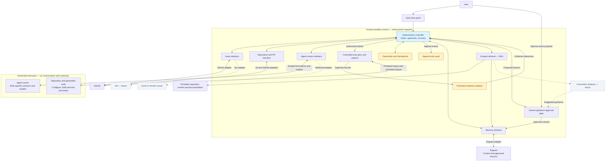

# Architecture overview

Status: required design, not implemented. Storage and enforcement technology remain
undecided. This diagram shows logical components, not separate services or agent order.

## Components and interfaces

Solid lines show intended initial connections; dashed lines show future capabilities
and integrations, not commitments for the first release.
Arrows show primary interactions, not every audit event or data transfer.

## Boundaries

- [Interfaces](interfaces.md) define our product's data and behaviour. Adapters
  translate providers into those contracts; named providers are not an exhaustive list.
- The core has no named-runner branches or provider SDK types. Runner, provider,
  and model choices resolve through capabilities and versioned adapter contracts.
- The workflow controls progression; agent outputs are claims to validate, not authority.
- [Execution isolation](execution.md) applies to agent sessions and their generated
  code, including subprocesses and build scripts. The boundary drawn is required,
  not evidence of a working sandbox. Untrusted outputs are validated before use.
- Credentialed external operations pass through authorized interfaces, not unrestricted
  agent credentials. Issue tracking and repository/PR delivery are separate contracts.
- Controlled capture supplies [revision-bound evidence](communication-protocol.md).
- Submit every workflow action to the audit: controller decisions and state
  transitions, agent dispatch and results, adapter operations, tool requests and
  executions, gates, approvals, retries, cancellations, recovery and external
  operations. Include rejection, denial, failure, timeout and unknown outcome. If an
  append fails, pause and notify the user. The user may retry, abort, or explicitly
  continue in audit-degraded mode. Preserve pending records for later backfill and
  disclose any permanent gap; never claim complete audit or compliance evidence for
  a degraded run. See [audit](audit.md).
- Run state and the immutable audit log have different update rules. Separate boxes
  do not require separate database servers; deployment is undecided. Checkpoints must
  reference durable audit coverage and protected artifacts; see [recovery](checkpoints.md).
- Engram provides context and human-approved lessons, not permission to advance gates.
- [RAG](retrieval.md) selects supporting context through role-scoped retrieval.
  Required instructions and task requirements are supplied directly, not selected by ranking.
- Local models need a capable agent runner, not just an inference endpoint.
- All context, evidence, and audit access must preserve role and test-visibility limits.
- Human approval of reusable lessons is initial behaviour; only automated convention
  discovery is future. Approved guidance never replaces required policy or gate evidence.

See the focused [workflow](workflow.md) and [recovery sequence](checkpoints.md) for
stage order, failure routing and crash ordering. [Audit](audit.md) defines the actual
immutability scope; the box label does not promise administrator-resistant storage.

## Future idea: codebase-convention analysis

Examine a project's established practices and use retrieved examples as evidence
for suggested guidance. The aim is code that fits the project, including its
architecture and idioms, not just its formatting.

Human-approved guidance could support TDD, implementation, and review through the
existing context interfaces. Observed habits are not automatically binding rules.
This is an incremental future capability, not a prerequisite for the initial
workflow. Its implementation and delivery stage remain open.

## Maintaining the diagrams

- Update this diagram with design changes affecting components or their connections.
- Keep diagram source in version control beside the design documents.
- Keep future integrations and unresolved decisions visibly distinct.
- Add focused workflow, state, or sequence diagrams when needed; keep this overview small.
- Diagrams and text must agree. Record unresolved differences rather than silently
  treating a drawing as a new design decision.
