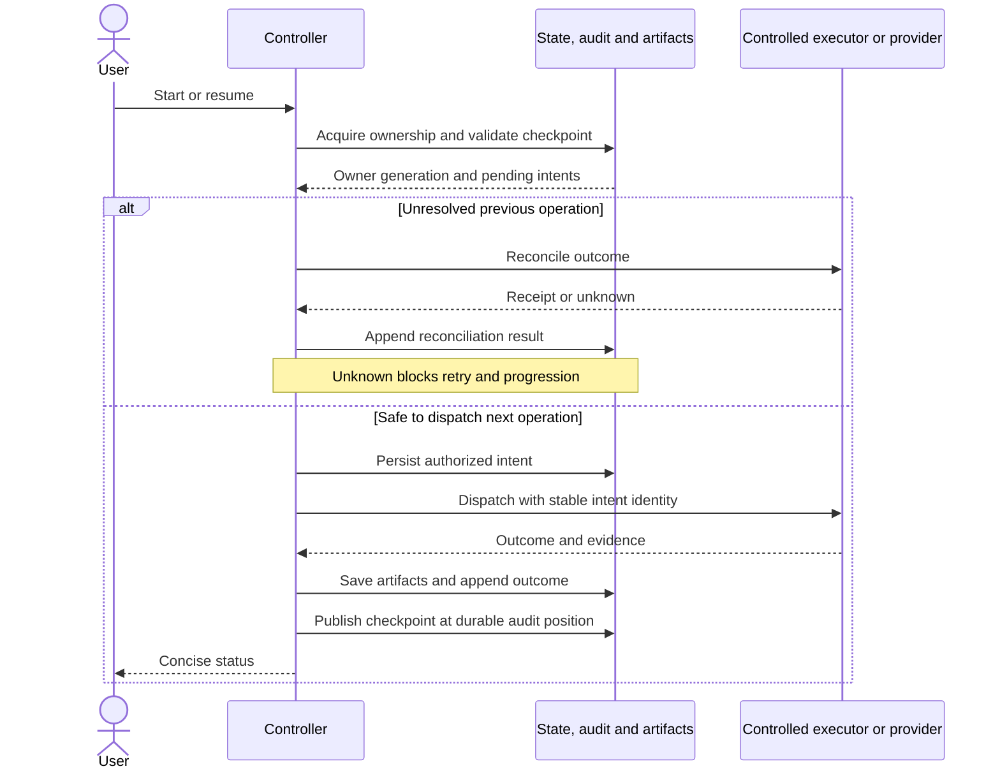

# Checkpoints and recovery

Status: agreed behaviour; not yet implemented. Storage and schema remain undecided.

## Purpose

Resume interrupted work from the last valid checkpoint instead of restarting the
whole task. A saved result is not automatically valid after an interruption.

## When to save

- After each completed stage or test batch, including its verification results.
- When pausing for approval, clarification, a dispute, or an exhausted limit.
- Before a GitHub write, record the intended action; afterwards, record its result.

Track the active stage or batch so an interruption cannot appear as completion.
Saving a checkpoint does not commit, push, create a PR, or approve anything.

## What to save

- Run, repository, issue, stage, batch, and checkpoint identifiers; timestamps.
- Task and plan versions, effective configuration, and applicable guardrails.
- Code and test identities, with recoverable working changes, not only commit IDs.
- Structured agent results and references to retained logs and verification evidence.
- Relevant tool and environment versions needed to assess evidence validity.
- Retry and dispute counts, pending questions, and recorded human approvals.
- GitHub action records and resulting issue, PR, or merge identifiers.
- The last completed step and the next expected action.
- Owner generation, input-bundle identity, durable audit position and outstanding
  operation intents, using the [record contract](communication-protocol.md).

## Exclusive ownership

Atomically acquire ownership for the provider/project/task and active run before
stage execution, resume or external mutation. GitHub labels display state; they
are not a lock. A concurrent start reports the existing owner instead of duplicating work.

Every invocation and operation carries a monotonically changing owner generation.
The authoritative controller/storage and mutation dispatcher reject stale generations.
Takeover is explicit and audited; expiry or a missing heartbeat is not proof the
old process stopped. Revoke old execution authority and reconcile in-flight effects
before allowing replacement-owner actions. Where a provider cannot fence an already
sent request, keep the run blocked until that request's outcome is resolved.

Lock/lease technology is undecided. Its contract must hold across all supported
workstations, not just within one process. Unsupported shared ownership is rejected.

## Save safely

Publish a checkpoint only when its required data and referenced artifacts are
durably saved. An interrupted save must leave the previous valid checkpoint usable.
If saving fails, stop progression and notify the user; do not claim it succeeded.

Persist intent before dispatching side-effecting operations. Persist resulting
artifacts and an outcome event before publishing a completed checkpoint. The
checkpoint names the durable audit position covering its claims. Use atomic
publication or a write-ahead protocol with reconciliation; no database is selected.

After a crash, reconcile pending operations before retry or progression. A remote
effect may have happened without its receipt being saved. Use one stable intent ID
and payload identity across retries. Never generate a new intent merely to evade an
unknown result. Identical completed operations reuse their receipt; different payloads
under one identity fail. Query the provider or use its idempotency facility when
available; if neither establishes a safe outcome, stop for a human decision.

An unknown outcome is not permission to retry. Manual decisions must explain how
the ambiguity was resolved or explicitly end the run; they cannot invent a receipt.

Keep checkpoint state under workflow control. Engram may hold contextual lessons,
but is not the authority for completed checks or approvals.

Do not store credentials. Preserve test visibility restrictions in saved artifacts,
logs, and resumed context. Runtime checkpoints are not public repository documents.

## Resume

1. On the next manual start, offer to resume the unfinished task.
2. Acquire valid ownership; validate the checkpoint, audit coverage and artifacts;
   preserve existing working changes.
3. Compare current code, tests, requirements, configuration, and relevant environment
   with the saved state. Invalidate affected results and approvals.
4. Repeat interrupted work and checks whose evidence is no longer valid. Keep retry
   counts and unresolved approval gates; restarting must not bypass them.
5. Before retrying a GitHub write, check whether it already succeeded. Reuse its
   confirmed result rather than creating duplicates. If uncertain, stop and notify.
6. Continue from the last valid checkpoint and record the recovery in the audit.

A missing or corrupt checkpoint must not trigger a silent restart or deletion of
work. Explain the problem and offer the available recovery choices.

## Approval validity

Approvals bind to the exact proposal/action and its relevant task, source, test,
policy and configuration identities. Record who approved and what they saw.
Approving a test correction does not approve a different correction or wider scope.

Each approval type declares its dependencies. Changed proposal content, changed
scope, or changed dependencies expire permission to act; retain the original event
historically. Unknown impact requires a fresh decision. Rejection and deferral never
authorize progression. Resuming cannot reset approvals, retry budgets or disputes.

## Recovery sequence

This sequence shows ordering, not a selected storage engine. Every write checks
current ownership; a failed write or unresolved outcome stops progression.

## Configuration

Expose checkpoint location, retention, optional extra save frequency, and recovery
behaviour. Defaults include saving at the boundaries above and offering manual
resume from the last valid checkpoint. Document each setting and its effect.

The storage mechanism, wire schema, lock implementation and retention defaults
remain undecided. The ownership and crash-ordering rules above are mandatory.
See [audit retention](audit.md) and [failure-injection evaluation](evaluation.md).
