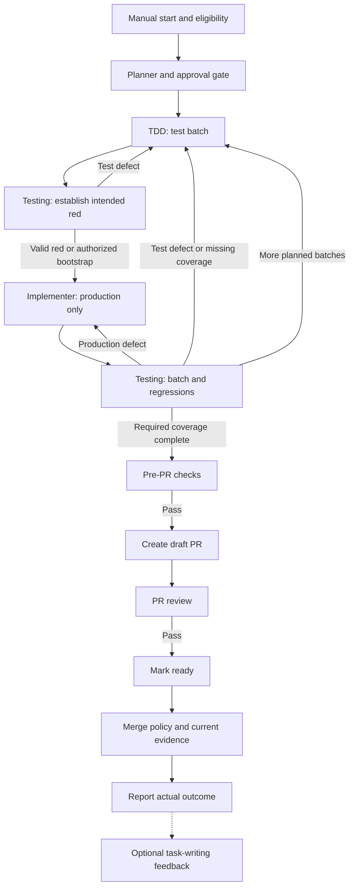

# Workflow and role handoffs

Status: agreed workflow; not implemented. One incoming task aims at one PR.
Smaller steps and test batches remain within it; no automatic issue/PR splitting.

## Intake and planning

Start manually with an explicit issue or a configurable shortlist/oldest-first
selection. The eligibility label is required in both cases. Validate configuration,
adapter capabilities and dependencies before claiming work. Unknown dependency status
blocks selection; it does not mean unblocked. Atomically claim the task before execution.

The planner reads the original task, requirements, acceptance criteria and constraints;
inspects relevant project context; and produces a concise plan, useful steps and size
assessment. Below Large and Large notify and proceed; XL+ requires approval. Any
unclear requirement or unexpected safety concern pauses at any size. See [planner](planner.md).

## Delivery

All arrows are controller-validated handoffs, not authority granted by agent prose.
At any stage: route fixes to the owning role; unclear requirements to planning;
disputes/approval requests to the user; environment failures to blocked recovery.
After repair, rerun affected checks and review before returning to publication/merge.
Bounds and checkpoints apply to every loop, including pre-PR and PR-review repair.
The diagram omits repeated error arrows for readability. Feedback may also run after
a failed, paused or cancelled run, but never becomes a delivery gate.

Testing owns execution assessment, TDD owns test changes and implementation owns
production changes. The controller dispatches tools and verifies records. Pre-PR,
PR creation, PR review and merge are separate responsibilities even where mechanical
steps are ordinary code rather than additional LLM calls.

Use [verification](verification.md) for meaningful red, interface bootstrap and
already-satisfied behaviour. A dispute has one review round by default, configurable;
unresolved disputes stop for the user. Limits cannot authorize weakened tests.

## Issue state and task changes

Mirror state using configurable labels, initially `ai:running`, `ai:awaiting-user`,
`ai:blocked` and `ai:completed`, plus an updated status comment naming run, stage and
checkpoint. These are a projection of controller state, not ownership or gate authority.
Failed status publication is recorded and retried safely; it must not look successful.

Removing the eligibility label requests a pause at the next safe checkpoint. Recheck
eligibility immediately before PR publication and merge. Restoring the label only
restores eligibility; it does not automatically resume work. Document the unavoidable
race with remote changes after dispatch and report any already-applied action honestly.

Preserve the original issue snapshot. Material edits pause for planner impact review;
invalidate affected plan, tests, evidence and approvals. Harmless wording edits do not
require a restart, but uncertain impact must not silently pass. Task text cannot alter
configuration or permissions. Scope growth is reassessed under the same size/risk rules.

## Completion and reporting

Merge requires current repository protections, configured approval and valid evidence
for the accepted revision/integration state. A ready PR is not a merge approval. If
merge is disabled or blocked, report ready/awaiting action, not completed-and-merged.
Mark `ai:completed` only when the task's configured completion conditions are met.

Every stopped or finished run gets a concise terminal report: outcome, issue/PR links,
tested and merged revisions where applicable, required check results, limitations,
pending actions and retained evidence references. Say “all configured checks passed”
only when supported; do not imply untested platforms or zero defects.

Unrelated findings do not expand the task. Report them; create follow-up issues only
with approval, label them `agent-discovered`, and list titles/links in the report.
Do not automatically add the execution-trigger label. Task-writing feedback and
[reusable lessons](learning.md) remain separate from the completion decision.
